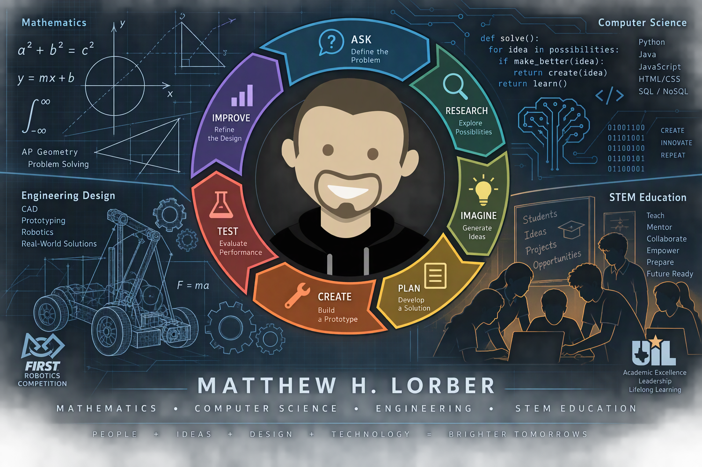

  

# Matthew H. Lorber

Texas-certified Mathematics and Computer Science educator with certifications in Mathematics (4-8, 8-12), Computer Science (8-12), Special Education (EC-12), ESL, and Career & Technical Education.

Experienced in STEM education, engineering design, robotics, and project-based learning. Mentor for FIRST Robotics Competition teams, coach of UIL Mathematics and Computer Science, and founder of a secondary Computer Science Club.

This GitHub profile showcases programming projects, educational resources, STEM activities, and technology solutions that support student learning and career readiness.

## Education & STEM Interests

- STEM Education
- Computer Science Education
- Engineering Design
- Robotics
- Computational Thinking
- Career & Technical Education (CTE)
- Project-Based Learning
- Educational Technology

## Technical Skills

- Python
- Java
- JavaScript
- HTML/CSS
- SQL / NoSQL
- CAD
- Full-Stack Web Development

## Current Focus

Building engaging learning experiences that connect mathematics, engineering, programming, and real-world problem solving. I am particularly interested in helping students explore STEM careers through robotics, engineering design, computer science, and project-based learning.

## Professional Certifications

- Computer Science 8-12
- Hospitality, Nutrition and Food Science 8-12
- Mathematics 4-8
- Mathematics 8-12
- Special Education EC-12
- ESL Supplemental

## Connect

📍 Cedar Park, Texas  
📧 matthew.lorber@outlook.com
